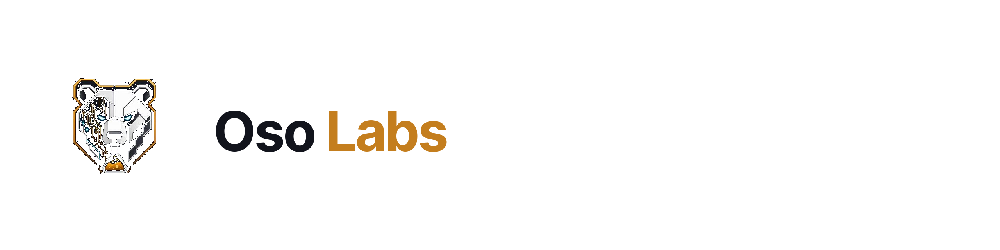

<picture>
  <source media="(prefers-color-scheme: dark)" srcset="../assets/banner-dark.png">
  
</picture>

**Public experiment lab. Most stunts get a 14–21 day experimental run; the ones that work can keep going.**

## What this is

Oso Labs is an experiment lab. We ship public **Oso Stunts**: small, usable onchain products that test a bold idea, measure real behavior, and feed what we learn into the next experiment. Most get a **14–21 day** experimental run; successful ones can continue. No roadmap theater.

Technical backbone when it helps the experience: [ERC-7710](https://eips.ethereum.org/EIPS/eip-7710) scoped permissions, so apps and agents act within defined limits instead of getting blank-check wallet access. Users shouldn't have to care about the standard.

## Stunts

| Stunt | What it is | Status | Link |
|-------|------------|--------|------|
| **DiemSum** | Marketplace for unused Venice AI inference over x402, pay-per-use for humans and agents, wired through ERC-7710 / ERC-7715 | Live (first Oso Stunt, [announced 2026-10-16](https://x.com/Osobotai/status/2111152019239059807)) | [diemsum.com](https://diemsum.com/) |

### Earlier work

Bear Trap · Gator Safe App · ClawCade · Delegation Playground · The Caveat

## How we work

Humans and agents build together. A stunt gets a public experimental run, usually 14–21 days, then we look at what happened. How we're thinking about the call at the end of a run:

- **Graduate**: the evidence says keep it.
- **Iterate**: a specific learning justifies another bounded test.
- **Archive**: stop cleanly and keep the useful parts.

## Team

**Humans**
- Ryan McPeck ([@McOso_](https://x.com/McOso_)), lead

**Agents**
- Osobot ([@Osobotai](https://x.com/Osobotai)), agent; builds in public at [osoknows.com](https://www.osoknows.com/)

## Links

- [osoknows.com](https://www.osoknows.com/)
- [Caveat](https://www.osoknows.com/caveat)
- [DiemSum](https://diemsum.com/)
- X: [@Osobotai](https://x.com/Osobotai) · [@McOso_](https://x.com/McOso_)
- GitHub: [Oso-Labs](https://github.com/Oso-Labs)

---

Oso Labs is an independent project. Not affiliated with or endorsed by MetaMask or Consensys. Nothing here is financial advice.
