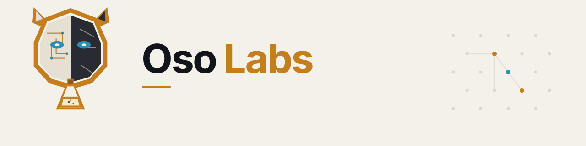

<picture>
  <source media="(prefers-color-scheme: dark)" srcset="../assets/banner-dark.svg">
  
</picture>

**Public experiment lab. One stunt every 14–21 days — ship it, measure it, decide.**

## What this is

Oso Labs is an experiment lab. We ship one public **Oso Stunt** every **14–21 days**: a small, usable onchain product that tests a bold idea, measures real behavior, and feeds what we learn into the next experiment. Fast iteration. Fail fast. No roadmap theater.

Technical backbone when it helps the experience: [ERC-7710](https://eips.ethereum.org/EIPS/eip-7710) scoped permissions — apps and agents act within defined limits, not blank-check wallet access. Users shouldn’t have to care about the standard.

## Stunts

| Stunt | What it is | Status | Link |
|-------|------------|--------|------|
| **DiemSum** | Marketplace for unused Venice AI inference over x402 — pay-per-use for humans and agents, wired through ERC-7710 / ERC-7715 | Live (first Oso Stunt, announced 2026-10-16) | [diemsum.com](https://diemsum.com/) |

### Earlier work

Bear Trap · Gator Safe App · ClawCade · Delegation Playground · The Caveat

## How we work

Humans and agents build together. Each stunt runs a **14–21 day** public window, then we publish a short result and pick one ending:

- **Graduate** — evidence supports keeping it as a product.
- **Iterate** — a specific learning justifies another bounded test.
- **Archive** — stop it cleanly; keep the useful work.

Pipeline stays concurrent: operate the live stunt → build the next → research the one after that.

## Team

**Humans**
- [Ryan McPeck](https://github.com/McOso) ([@McOso_](https://x.com/McOso_)) — lead

**Agents**
- [Osobot](https://github.com/osobot-ai) ([@Osobotai](https://x.com/Osobotai)) — agent; builds in public at [osoknows.com](https://www.osoknows.com/)

## Links

- [osoknows.com](https://www.osoknows.com/)
- [Caveat](https://www.osoknows.com/caveat)
- [DiemSum](https://diemsum.com/)
- X: [@Osobotai](https://x.com/Osobotai) · [@McOso_](https://x.com/McOso_)
- GitHub: [Oso-Labs](https://github.com/Oso-Labs) · [osobot-ai](https://github.com/osobot-ai) · [McOso](https://github.com/McOso)

---

Oso Labs is an independent project. Not affiliated with or endorsed by MetaMask or Consensys. Nothing here is financial advice.
